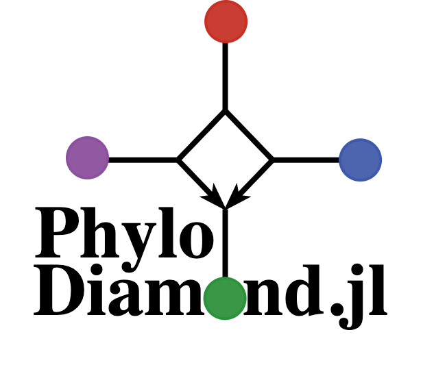

# PhyloDiamond.jl <picture> <source media="(prefers-color-scheme: dark)" srcset="docs/logo_unrooted_trans.png"></picture>

[](https://github.com/solislemuslab/PhyloDiamond.jl/actions/workflows/CI.yml)
[](https://codecov.io/gh/solislemuslab/PhyloDiamond.jl)
[](https://solislemuslab.github.io/PhyloDiamond.jl/dev)

## Overview

`PhyloDiamond.jl` is a [Julia](http://julialang.org/) package for ultrafast learning of 4-node hybridization cycles in phylogenetic networks using algebraic invariants.

Input data:
- A concordance factor table, or
- A file containing gene trees

## Usage

`PhyloDiamond.jl` is a Julia package, so the user needs to first install Julia, and then install the package.

To install Julia, follow the instructions in [here](https://julialang.org/downloads/).

To install the package, type inside Julia:
```julia
]
add PhyloDiamond
```

## Help and errors

To get help, check the documentation [here](https://solislemuslab.github.io/PhyloDiamond.jl/dev). Please report any bugs and errors by opening an
[issue](https://github.com/solislemuslab/PhyloDiamond.jl/issues/new).

## Citation

If you use `PhyloDiamond.jl` in your work, we kindly ask that you cite the following paper: 
```
@article{wu_solis-lemus_2024,
author = {Wu, Zhaoxing and Sol{\'i}s-Lemus, Claudia},
year = {2024},
title = {{Ultrafast learning of four-node hybridization cycles in phylogenetic networks using algebraic invariants}},
journal = {Bioinformatics Advances},
volume = {4},
number = {1},
pages = {vbae014},
doi = {10.1093/bioadv/vbae014}
}
```

## License

`PhyloDiamond.jl` is licensed under a
[MIT License](https://github.com/solislemuslab/PhyloDiamond.jl/blob/master/LICENSE).


## Contributions

Users interested in expanding functionalities in `PhyloDiamond.jl` are welcome to do so. See details on how to contribute in [CONTRIBUTING.md](https://github.com/solislemuslab/PhyloDiamond.jl/blob/master/CONTRIBUTING.md).

                        
