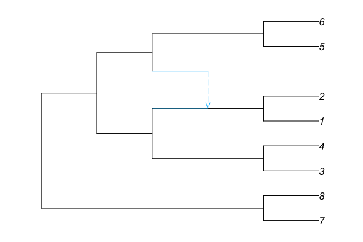

# Input and output

`phylo_diamond` takes either a file of gene trees or a table of concordance
factors (CFs), and returns the `m` networks that fit the data best.

```julia
phylo_diamond(gene_trees_filename::String, m::Int, output_filename::String = "phylo_diamond.txt")
phylo_diamond(cf::DataFrame,               m::Int, output_filename::String = "phylo_diamond.txt")
```

- `m`: how many networks to report. We recommend `m = 5`.
- `output_filename`: the text file the report is written to (see [Output](@ref io-output)).

PhyloDiamond needs **at least 6 taxa**.

## Input 1: a file of gene trees

A text file with one gene tree per line, in newick format.
Taxon names can be any text, but they must be the same across gene trees.
Branch lengths and support values are allowed but not used: PhyloDiamond only uses
each gene tree's unrooted topology. PhyloDiamond counts, for every set of 4 taxa,
how often each of the three quartet topologies appears in the gene trees.

```julia
using PhyloDiamond
res = phylo_diamond("genetrees.tre", 5)
```

## Input 2: a table of concordance factors

Use this if you already have CFs, for example from gene trees with
uncertainty taken into account, or from another program.

The table must be a `DataFrame` with **7 columns, in this order**:

| columns 1–4 | column 5 | column 6 | column 7 |
|:------------|:---------|:---------|:---------|
| taxa `a, b, c, d` | CF of `ab\|cd` | CF of `ac\|bd` | CF of `ad\|bc` |

- PhyloDiamond uses the columns by **position**, not by name.
- The table must have a row for **every** set of 4 taxa: with ``n`` taxa,
  ``\binom{n}{4}`` rows. Otherwise `phylo_diamond` stops with the error
  "Please provide a complete cf table".

To see the format, here is the table that PhyloDiamond builds from the example gene trees:

```@example io
using PhyloDiamond
genetrees = joinpath(pkgdir(PhyloDiamond), "test", "file", "gt.txt")
df = generate_cf_from_gene_trees(genetrees)
first(df, 3)
```

Running `phylo_diamond(df, 5)` on this table gives the same result as
`phylo_diamond(genetrees, 5)`. Building the table once is useful when you want to
run PhyloDiamond several times on the same data.

To read a table saved as a CSV file:

```julia
using CSV, DataFrames
df = DataFrame(CSV.File("CFtable.csv"))
df = df[:, [:t1, :t2, :t3, :t4, :CF12_34, :CF13_24, :CF14_23]] # keep the 7 columns, in this order
res = phylo_diamond(df, 5)
```

Change the column names to match your file. A CF table written by
PhyloNetworks or SNaQ uses the column names above.

## [Output](@id io-output)

`phylo_diamond` gives its result in three ways.

**1. A printed report**, for example:

```
Inference of top 5 8-taxon phylogenetic networks with phylogenetic invariants
1. N2222 (0.03689157145883046)
[(1,2),(3,4),(5,6),(7,8)]
((7:1,8:1):4, (((3:1,4:1):2, ((1:1,2:1):1)#H1:1::0.7):1, (#H1:1::0.3,(5:1,6:1):2):1):1);
2. N2222 (0.03823994257144703)
[(1,2),(5,6),(3,4),(7,8)]
((7:1,8:1):4, (((5:1,6:1):2, ((1:1,2:1):1)#H1:1::0.7):1, (#H1:1::0.3,(3:1,4:1):2):1):1);
...
```

Each network takes three lines:

1. its rank, its type and its score. `N2222` gives the number of taxa in the clades
   `n0`, `n1`, `n2`, `n3`. A smaller score means the data fit that network better.
   Networks with the same score get the same rank;
2. the taxa in `n0` (hybrid clade), `n1` and `n2` (parent clades), and `n3` (the rest);
3. the network in extended newick format.

**2. The same report in a text file**, `output_filename` (`phylo_diamond.txt` by
default). If the file already exists, the new report is **added at the end**:
use a new file name for each analysis, or delete the old file first.

**3. A dictionary** from rank to newick string:

```julia
res[1] # newick string of the best network
```

Keys run from 1 to `m`. A `Dict` is unordered, so print `res[1]`, `res[2]`, ...
rather than `res` itself to see the networks in rank order.

### What the newick string does and does not tell you

The newick string is a convenient way to plot the network or use it in other
programs. Only its **clades** are estimated. The branch lengths (1, 2, 4) and
inheritance probabilities (0.7, 0.3) are always the same placeholders.
Clades with 3 or more taxa are written as polytomies, for example `(7:1,8:1,9:1)`:
PhyloDiamond does not resolve relationships inside a clade.

To plot a network, use [PhyloNetworks](https://github.com/JuliaPhylo/PhyloNetworks.jl)
and [PhyloPlots](https://github.com/JuliaPhylo/PhyloPlots.jl):

```julia
using PhyloNetworks, PhyloPlots
net = readnewick(res[1])
plot(net)
```



To estimate branch lengths and inheritance probabilities for the best network,
you can use it as a starting network in [SNaQ](https://github.com/JuliaPhylo/SNaQ.jl).

## More than 8 taxa

With 6 to 8 taxa, PhyloDiamond scores every possible network
(1080 for 6 taxa and 2520 for 7 or 8 taxa). With more than 8 taxa, it scores
every network on every subset of 8 taxa, and then adds the remaining taxa to the
clades of the best networks. Running time grows with the number of
8-taxon subsets, ``\binom{n}{8}``. For example, there are 9 subsets for 9 taxa and
125,970 for 20 taxa.
